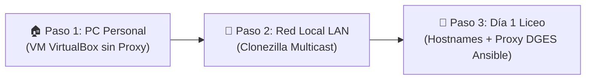

# 🖥️ Asistente POITE · DGES Uruguay

Suite interactiva en **Bash** para la administración ágil, diagnóstico de redes, mantenimiento de sistemas, preparación de imágenes maestras en VirtualBox, clonación masiva con Clonezilla y orquestación con Ansible en laboratorios educativos **GNU/Linux** de la **Dirección General de Educación Secundaria (DGES - ANEP)** y la comunidad educativa pública uruguaya.

Desarrollado y mantenido por el **Prof. Gabriel Vázquez** (Docente de Informática egresado de INET / CFE).

[](https://www.gnu.org/licenses/gpl-3.0)
[](https://www.gnu.org/software/bash/)
[](https://www.ansible.com)
[](https://clonezilla.org)
[](https://www.kernel.org)
[](mailto:gabriel.vazquez@docente.ceibal.edu.uy)

---

## 🎯 Niveles de Experiencia del POITE (Interfaz Adaptativa)

En las instituciones educativas uruguayas, los docentes y Profesores Orientadores en Informática y Tecnología Educativa (**POITE**) provienen de formaciones diversas. El **Asistente POITE** ofrece tres niveles de interfaz adaptables con un solo clic:

```text
======================================================================
  🌱 1) Modo Básico / Asistido:
     Para docentes sin experiencia en administración Linux. Interfaz en lenguaje
     humano de 3 botones con "Piloto Automático" (cero comandos de terminal).

  🛠️  2) Modo Intermedio / Administrador de Aula (Estándar):
     Flujo metódico completo DGES con paneles temáticos organizados por tareas:
     Red, Usuarios, Mantenimiento, Instalaciones y Control de Clases.

  💻 3) Modo Avanzado / SysAdmin & DevOps:
     Para técnicos de laboratorio e ingenieros. Consola ad-hoc de Ansible,
     edición libre de inventarios .ini y playbooks YAML, sockets Python y Nmap.
======================================================================
```
> Puede alternar entre niveles en cualquier momento pulsando **`N`** o desde el menú de configuración.

---

## ⚡ Metodología Operativa: Flujo de Inicio de Año (DGES)

Al comienzo del ciclo lectivo, los equipos del aula se formatean y acondicionan. El asistente estructura este proceso en la secuencia real de trabajo del docente:



### 1. 🏠 Paso 1: Preparación de la Imagen Maestra en PC Personal (VirtualBox)
* **Conexión Directa a Internet:** La máquina de referencia se acondiciona en la computadora personal del docente con fibra óptica y sin proxy institucional.
* **Acondicionamiento Integral:** Actualiza el sistema operativo, crea la cuenta estándar de estudiante (`alumno`), configura el inicio de sesión automático (autologin de escritorio), habilita OpenSSH Server y pre-inyecta la clave SSH del docente (`authorized_keys`) para permitir acceso remoto sin contraseñas desde el día 1.
* **Software Pedagógico:** Instala LibreOffice en español, suite educativa (GIMP, Geogebra, Thonny, Scratch, Geany), Google Chrome y Visual Studio Code.
* **Sellado y Sysprep Linux:** Resetea `/etc/machine-id` a 0 bytes para evitar la colisión crítica de IPs en el switch/DHCP del liceo; elimina llaves de host SSH viejas; instala el servicio `poite-firstboot.service` que generará identidad criptográfica única en cada PC física; y apaga la VM de forma segura.

### 2. 🚀 Paso 2: Distribución en Red con Clonezilla Multicast
* **Operación 100% Local:** La clonación por red hacia las 25-30 PCs del aula se realiza en la red local LAN (sin requerir salida a Internet ni proxy).
* **Velocidad:** Mediante Clonezilla Lite Server en modo Multicast, todas las computadoras del aula se clonan simultáneamente en 15 a 25 minutos.

### 3. 🏫 Paso 3: Post-Clonación Día 1 en el Liceo (Hostnames y Proxy DGES con Ansible)
Al encender las PCs físicas en el liceo, cada una arranca con identidad única, autologin y SSH listo, pero aún sin acceso a Internet:
* **Mapeo del Aula:** El docente escanea la subred escolar y detecta las IPs de todas las computadoras encendidas.
* **Asignación Secuencial de Hostnames:** Vía SSH, renombra en lote las PCs (`lab1-pc01`, `lab1-pc02`... `lab1-pc30`) y genera automáticamente el inventario `inventario_ansible.ini`.
* **Despliegue Masivo de Proxy DGES:** Con el playbook `09_configurar_proxy_aula.yml`, el docente **inyecta el Proxy DGES (`10.4.142.24:8080`) en todas las computadoras del aula en un solo clic** (APT, DNF, `/etc/environment`, `/etc/profile.d`, `/etc/wgetrc` y `sudoers`).
* **Verificación y Control con Ansible:** Prueba de Internet en todo el aula, sincronización horaria inmediata y disponibilidad para enviar avisos a pantalla o apagar el laboratorio al finalizar la jornada.

---

## 🚀 Instalación y Acceso Global (`poite`)

Puedes ejecutar el asistente directamente o instalar el comando global para abrirlo en cualquier momento desde la terminal con una sola palabra:

### Opción 1: Instalación del Comando Global (Recomendada)
```bash
git clone https://github.com/gavafue/POITE-Scripts-SH-DGES.git
cd POITE-Scripts-SH-DGES
sudo ./instalar_comando.sh
```
Una vez instalado, simplemente escribe en cualquier consola:
```bash
poite
```

### Opción 2: Ejecución Directa
```bash
cd POITE-Scripts-SH-DGES
chmod +x menu.sh
./menu.sh
```

---

## 🧭 Estructura y Módulos de la Suite

```text
POITE-Scripts-SH-DGES/
├── menu.sh                         # 🖥️ Menú principal interactivo con selector dinámico de nivel de experiencia
├── instalar_comando.sh             # 🚀 Enlace y lanzador global /usr/local/bin/poite
├── lib/
│   ├── comun.sh                    # 🧰 Librería central: motor multi-distro, capas de abstracción y niveles POITE
│   └── servidor_aprovisionamiento.py # 🌐 Servidor HTTP para aprovisionamiento SSH exprés y callbacks
├── submenus/
│   ├── modo_basico.sh              # 🌱 Interfaz asistida en 3 botones para docentes sin experiencia Linux
│   ├── modo_avanzado.sh            # 💻 Interfaz SysAdmin & DevOps con consola ad-hoc y playbooks YAML
│   ├── red.sh                      # 🌐 Submenú de Red y Conectividad
│   ├── usuarios.sh                 # 👥 Submenú de Usuarios y Cuentas
│   ├── mantenimiento.sh            # 🧹 Submenú de Mantenimiento Preventivo y Correctivo
│   ├── instalaciones.sh            # 🧩 Submenú de Instalaciones Frecuentes
│   └── sistema.sh                  # 💻 Submenú de Auditoría de Hardware y Sistema
├── ImagenMaestra/                   # 📦 Módulo de Preparación y Sellado de Imagen Maestra
│   ├── menu_imagen_maestra.sh      # Submenú de gestión de la VM / Imagen de referencia
│   ├── preparar_imagen_maestra.sh  # Asistente en PC personal (Internet directo, Alumno, Autologin, SSH, Software)
│   ├── generalizar_para_clonar.sh  # Sysprep Linux: vaciado de machine-id, llaves SSH y apagado seguro
│   └── guia_clonezilla.sh          # Guía práctica para clonación masiva por red con Clonezilla Multicast
├── PostClonacion/                  # 🚀 Módulo Post-Clonación Día 1 y Control con Ansible
│   └── menu_post_clonacion.sh      # Mapeo, hostnames lab1-pcXX, despliegue masivo de Proxy DGES y playbooks
├── ReplicacionAula/                # 🔄 Módulo de Replicación Alternativa (Sin Clonar Discos)
│   ├── menu_replicacion.sh         # Submenú de replicación de configuración por red
│   ├── capturar_perfil_maestro.sh  # Captura software, usuarios y ajustes de la PC de referencia
│   ├── ver_perfil_maestro.sh       # Visualizador estructurado del perfil maestro
│   └── desplegar_perfil_remoto.sh  # Despliegue en red vía Ansible o bucle SSH nativo
├── Red/
│   ├── proxy_DGES.sh               # 🛡️ Gestor integral de Proxy DGES local (APT, DNF, env, sudoers, wget)
│   ├── mapear_red_equipos.sh       # 🗺️ Escaneo de subred, resolución de hostnames y alerta de ausentes
│   ├── asignar_hostname.sh         # 🏷️ Asignación de hostname local, remoto o en lote secuencial
│   ├── despliegue_ssh_aula.sh      # 🚀 Despliegue automatizado de SSH (Servidor HTTP / Pendrive USB)
│   ├── ejecutar_ansible_aula.sh    # 🤖 Lanzador guiado de playbooks de Ansible para el laboratorio
│   ├── diagnostico_red.sh          # ⚡ Test exprés de conectividad, Gateway, DNS y Ceibal
│   ├── reiniciar_red.sh            # 🔄 Reinicio seguro de NetworkManager y networking
│   ├── conexion_remota.sh          # 📤 Distribución y ejecución remota por SSH (por IP o MAC)
│   └── gestor_registros_red.sh     # 📋 Administrador de listas de IPs y MACs del laboratorio
├── Usuarios/
│   ├── crear_usuario.sh            # ➕ Creación individual con asignación de grupo (sudo / wheel)
│   ├── crear_usuarios_lote.sh      # 📂 Importación masiva por CSV con shell /bin/bash y CRLF fix
│   ├── cambiar_usuario.sh          # 🔁 Autologin multi-display manager (LightDM, GDM3, GDM, SDDM)
│   ├── resetear_password.sh        # 🔑 Restablecimiento asistido de contraseñas
│   └── eliminar_usuario.sh         # ➖ Eliminación segura con protección de cuentas críticas
├── Mantenimiento/
│   ├── arreglar_reloj_ubuntu.sh    # 🕒 Sincronización NTP (Chrony / timesyncd) y reloj CMOS de BIOS
│   ├── reparar_dependencias.sh     # 🧱 Reparación adaptativa según gestor (APT, DNF, Pacman, Zypper)
│   ├── chequear_repositorios.sh    # 📦 Verificación dinámica de repositorios oficiales
│   ├── limpieza_disco.sh           # 🧹 Liberación de espacio (cachés de paquetes, thumbnails, logs)
│   └── ssh.sh                      # 🔐 Instalación, arranque y enlace al despliegue masivo de SSH
├── InstalacionesFrecuentes/
│   ├── instalar_ansible.sh         # 🤖 Instalador de Ansible, sshpass y generación de playbooks escolares
│   ├── instalar_visual_studio_code.sh # 🧑‍💻 VS Code oficial multi-distro (repositorios APT/DNF/Zypper/Arch)
│   ├── instalar_chrome.sh          # 🌐 Google Chrome oficial (.deb / .rpm) con validación de arquitectura
│   ├── instalar_brave.sh           # 🦁 Brave Browser oficial adaptado a la distribución
│   ├── instalar_wine.sh            # 🍷 WineHQ y Winetricks adaptado a Debian, Fedora, Arch y SUSE
│   └── suite_educativa.sh          # 📚 Suite clasificada por áreas con mapeo de paquetes multi-distro
├── ansible/                        # 📁 Entorno de orquestación de Ansible para el aula
│   ├── ansible.cfg                 # Configuración optimizada para laboratorios educativos
│   └── playbooks/                  # Playbooks pedagógicos listos para producción
│       ├── 01_ping_aula.yml        # Test de conectividad masivo
│       ├── 02_sincronizar_reloj.yml# Sincronización horaria (Montevideo) y reloj hardware
│       ├── 03_actualizar_paquetes.yml # Actualización masiva de software (APT/DNF)
│       ├── 04_crear_usuario_alumno.yml# Creación o aseguramiento de cuenta alumno
│       ├── 05_apagar_aula.yml      # Apagado coordinado al terminar el turno
│       ├── 06_verificar_proxy_internet.yml # Verificación masiva de proxy e Internet
│       ├── 07_reiniciar_aula.yml   # Reinicio masivo de máquinas
│       ├── 08_notificar_alumnos.yml# Mensajes y avisos a las pantallas de estudiantes
│       ├── 09_configurar_proxy_aula.yml # Inyección masiva de Proxy DGES en todo el laboratorio
│       └── 10_desactivar_proxy_aula.yml # Desactivación masiva de proxy
└── RegistrarIP/                    # 📁 Directorio central de persistencia
    ├── config_poite.conf           # Configuración del nivel de experiencia del POITE
    ├── ips.txt                     # Listado de IPs registradas
    ├── macs.txt                    # Listado de MACs registradas
    ├── inventario_ansible.ini      # Inventario dinámico generado para Ansible
    ├── remoto.sh                   # Script a distribuir remotamente por el aula
    └── registro_ejecuciones.log    # Historial de ejecuciones
```

---

## 👤 Autor

**Prof. Gabriel Vázquez**  
*Docente de Informática — Uruguay*  
* Instituto Normal de Enseñanza Técnica (INET - CFE / ANEP)
* DGETP - UTU · Instituto Superior Brazo Oriental (ISBO)
* DGES - Secundaria · POITE en Educación Media
* 📧 Correo: [gabriel.vazquez@docente.ceibal.edu.uy](mailto:gabriel.vazquez@docente.ceibal.edu.uy)
* 💼 LinkedIn: [linkedin.com/in/gavafue](https://www.linkedin.com/in/gavafue)

---

## 📄 Licencia

Este proyecto se distribuye bajo la Licencia **GPL-3.0**. Libre para uso, estudio, modificación y redistribución en toda la comunidad educativa pública.
