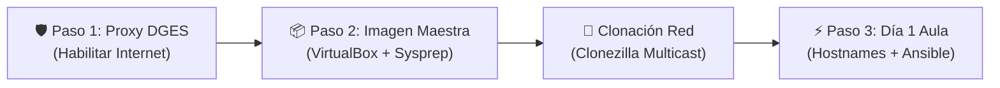

# 🖥️ Asistente POITE · DGES Uruguay

Suite interactiva en **Bash** para la administración ágil, diagnóstico de redes, mantenimiento de sistemas, preparación de imágenes maestras en VirtualBox, clonación masiva con Clonezilla y orquestación con Ansible en laboratorios educativos **GNU/Linux** de la **Dirección General de Educación Secundaria (DGES - ANEP)** y la comunidad educativa pública uruguaya.

Desarrollado y mantenido por el **Prof. Gabriel Vázquez** (Docente de Informática egresado de INET / CFE).

[](https://www.gnu.org/licenses/gpl-3.0)
[](https://www.gnu.org/software/bash/)
[](https://www.ansible.com)
[](https://clonezilla.org)
[](https://www.kernel.org)
[](mailto:gabriel.vazquez@docente.ceibal.edu.uy)

---

## 🎯 Flujo de Trabajo en el Laboratorio: Ciclo Completo DGES

Al comienzo del año lectivo, los laboratorios de informática liceales se formatean y acondicionan. El **Asistente POITE** estructura este proceso en un flujo de tres fases metodológicas impecables:



### 1. 🛡️ Paso 1: Acceso a Internet vía Proxy Institucional DGES
En los liceos y salas de informática no existe salida directa a Internet; se requiere el proxy institucional (por defecto `10.4.142.24:8080`). Sin este ajuste, la terminal no puede descargar paquetes ni repositorios.
* El módulo configura simultáneamente: **APT**, **DNF**, `/etc/environment` (PAM global), `/etc/profile.d/proxy-dges.sh` (terminales interactivas), `/etc/wgetrc` y `/etc/sudoers.d/99-proxy-env` (`env_keep` para evitar que `sudo` descarte el proxy).
* Incluye comprobación automática inmediata contra portales educativos (`uruguayeduca.anep.edu.uy`).

### 2. 📦 Paso 2: Preparación y Sellado de la Imagen Maestra (VirtualBox / Clonezilla)
El docente construye una máquina virtual en VirtualBox que sirve de "Golden Master":
* **Acondicionamiento Integral:** Configura el Proxy DGES, actualiza el sistema, crea el usuario `alumno`, habilita el autologin en el escritorio, instala OpenSSH Server y pre-inyecta la clave pública SSH del docente para control remoto sin contraseñas.
* **Instalación de Software:** Suite educativa (LibreOffice, GIMP, Geogebra, Scratch, Thonny), navegadores web (Chrome / Brave) y Visual Studio Code.
* **Sellado y Generalización (Linux Sysprep):** Resetea `/etc/machine-id` a 0 bytes para evitar que todas las PCs clonadas reciban la misma IP por DHCP; elimina llaves de host SSH viejas; instala el servicio `poite-firstboot.service` para regenerar claves únicas por hardware en el primer arranque físico; y purga historiales, temporales y cachés antes de apagar.
* **Distribución Multicast:** Guía paso a paso para clonar todo el laboratorio simultáneamente en 20 minutos con Clonezilla Lite Server.

### 3. 🚀 Paso 3: Post-Clonación Día 1 (Hostnames e Inventario Ansible)
Una vez que las computadoras del aula encienden con la imagen clonada:
* Cada PC arranca con identidad única (`machine-id`), autologin listo, proxy funcional y SSH abierto para el docente.
* Desde la máquina principal se mapea la subred, se asignan en lote nombres secuenciales estandarizados (`lab1-pc01`, `lab1-pc02`... `lab1-pc30`) y se genera automáticamente el inventario `inventario_ansible.ini`.
* ¡El docente toma el control del aula con **Ansible desde el Día 1**! (Ping masivo, sincronización horaria, notificaciones en pantalla y apagado coordinado).

---

## 🚀 Instalación y Acceso Global (`poite`)

Puedes ejecutar el asistente directamente o instalar el comando global para abrirlo en cualquier momento desde la terminal con una sola palabra:

### Opción 1: Instalación del Comando Global (Recomendada)
```bash
git clone https://github.com/gavafue/POITE-Scripts-SH-DGES.git
cd POITE-Scripts-SH-DGES
sudo ./instalar_comando.sh
```
Una vez instalado, simplemente escribe en cualquier consola:
```bash
poite
```

### Opción 2: Ejecución Directa
```bash
cd POITE-Scripts-SH-DGES
chmod +x menu.sh
./menu.sh
```

---

## 🧭 Estructura y Módulos de la Suite

```text
POITE-Scripts-SH-DGES/
├── menu.sh                         # 🖥️ Menú principal interactivo con estado en vivo y ciclo DGES
├── instalar_comando.sh             # 🚀 Enlace y lanzador global /usr/local/bin/poite
├── lib/
│   ├── comun.sh                    # 🧰 Librería central: motor multi-distro, capas de abstracción y red
│   └── servidor_aprovisionamiento.py # 🌐 Servidor HTTP para aprovisionamiento SSH exprés y callbacks
├── ImagenMaestra/                   # 📦 Módulo de Preparación y Sellado de Imagen Maestra
│   ├── menu_imagen_maestra.sh      # Submenú interactivo de gestión de la VM / Imagen
│   ├── preparar_imagen_maestra.sh  # Asistente guiado todo en uno (Proxy, Alumno, Autologin, SSH, Software)
│   ├── generalizar_para_clonar.sh  # Sysprep Linux: vaciado de machine-id, llaves SSH y apagado seguro
│   └── guia_clonezilla.sh          # Guía práctica para clonación masiva por red con Clonezilla Multicast
├── PostClonacion/                  # 🚀 Módulo Post-Clonación Día 1 y Control con Ansible
│   └── menu_post_clonacion.sh      # Descubrimiento, asignación lab1-pcXX, inventario y playbooks de aula
├── ReplicacionAula/                # 🔄 Módulo de Replicación Alternativa (Sin Clonar Discos)
│   ├── menu_replicacion.sh         # Submenú de replicación de configuración por red
│   ├── capturar_perfil_maestro.sh  # Captura software, usuarios y ajustes de la PC de referencia
│   ├── ver_perfil_maestro.sh       # Visualizador estructurado del perfil maestro
│   └── desplegar_perfil_remoto.sh  # Despliegue en red vía Ansible o bucle SSH nativo
├── Red/
│   ├── proxy_DGES.sh               # 🛡️ Gestor integral de Proxy DGES (APT, DNF, env, sudoers, wget)
│   ├── mapear_red_equipos.sh       # 🗺️ Escaneo de subred, resolución de hostnames y alerta de ausentes
│   ├── asignar_hostname.sh         # 🏷️ Asignación de hostname local, remoto o en lote secuencial
│   ├── despliegue_ssh_aula.sh      # 🚀 Despliegue automatizado de SSH (Servidor HTTP / Pendrive USB)
│   ├── ejecutar_ansible_aula.sh    # 🤖 Lanzador guiado de playbooks de Ansible para el laboratorio
│   ├── diagnostico_red.sh          # ⚡ Test exprés de conectividad, Gateway, DNS y Ceibal
│   ├── reiniciar_red.sh            # 🔄 Reinicio seguro de NetworkManager y networking
│   ├── conexion_remota.sh          # 📤 Distribución y ejecución remota por SSH (por IP o MAC)
│   └── gestor_registros_red.sh     # 📋 Administrador de listas de IPs y MACs del laboratorio
├── Usuarios/
│   ├── crear_usuario.sh            # ➕ Creación individual con asignación de grupo (sudo / wheel)
│   ├── crear_usuarios_lote.sh      # 📂 Importación masiva por CSV con shell /bin/bash y CRLF fix
│   ├── cambiar_usuario.sh          # 🔁 Autologin multi-display manager (LightDM, GDM3, GDM, SDDM)
│   ├── resetear_password.sh        # 🔑 Restablecimiento asistido de contraseñas
│   └── eliminar_usuario.sh         # ➖ Eliminación segura con protección de cuentas críticas
├── Sistema/
│   ├── completo.sh                 # 📋 Auditoría integral consolidada del puesto
│   ├── so.sh                       # 🏷️ Sistema operativo, familia, versión y entorno gráfico
│   ├── cpu.sh                      # 🧠 Información detallada de CPU (lscpu, modelo, núcleos)
│   ├── memoria.sh                  # 🪫 Memoria RAM y Swap con porcentaje de ocupación
│   ├── discos.sh                   # 💽 Almacenamiento, puntos de montaje y particiones
│   ├── hardware.sh                 # 🖧 Reporte completo de hardware con lshw
│   ├── procesos.sh                 # 🧮 Visor interactivo de procesos activos
│   ├── kernel.sh                   # 🧩 Versión del kernel Linux y arquitectura
│   └── variables.sh                # 📦 Variables de entorno de la sesión
├── Mantenimiento/
│   ├── arreglar_reloj_ubuntu.sh    # 🕒 Sincronización NTP (Chrony / timesyncd) y reloj CMOS de BIOS
│   ├── reparar_dependencias.sh     # 🧱 Reparación adaptativa según gestor (APT, DNF, Pacman, Zypper)
│   ├── chequear_repositorios.sh    # 📦 Verificación dinámica de repositorios oficiales
│   ├── limpieza_disco.sh           # 🧹 Liberación de espacio (cachés de paquetes, thumbnails, logs)
│   └── ssh.sh                      # 🔐 Instalación, arranque y enlace al despliegue masivo de SSH
├── InstalacionesFrecuentes/
│   ├── instalar_ansible.sh         # 🤖 Instalador de Ansible, sshpass y generación de playbooks escolares
│   ├── instalar_visual_studio_code.sh # 🧑‍💻 VS Code oficial multi-distro (repositorios APT/DNF/Zypper/Arch)
│   ├── instalar_chrome.sh          # 🌐 Google Chrome oficial (.deb / .rpm) con validación de arquitectura
│   ├── instalar_brave.sh           # 🦁 Brave Browser oficial adaptado a la distribución
│   ├── instalar_wine.sh            # 🍷 WineHQ y Winetricks adaptado a Debian, Fedora, Arch y SUSE
│   └── suite_educativa.sh          # 📚 Suite clasificada por áreas con mapeo de paquetes multi-distro
├── ansible/                        # 📁 Entorno de orquestación de Ansible para el aula
│   ├── ansible.cfg                 # Configuración optimizada para laboratorios educativos
│   └── playbooks/                  # Playbooks pedagógicos listos para producción
│       ├── 01_ping_aula.yml        # Test de conectividad masivo
│       ├── 02_sincronizar_reloj.yml# Sincronización horaria (Montevideo) y reloj hardware
│       ├── 03_actualizar_paquetes.yml # Actualización masiva de software (APT/DNF)
│       ├── 04_crear_usuario_alumno.yml# Creación o aseguramiento de cuenta alumno
│       ├── 05_apagar_aula.yml      # Apagado coordinado al terminar el turno
│       ├── 06_verificar_proxy_internet.yml # Verificación masiva de proxy e Internet
│       ├── 07_reiniciar_aula.yml   # Reinicio masivo de máquinas
│       └── 08_notificar_alumnos.yml# Mensajes y avisos a las pantallas de estudiantes
└── RegistrarIP/                    # 📁 Directorio central de persistencia
    ├── ips.txt                     # Listado de IPs registradas
    ├── macs.txt                    # Listado de MACs registradas
    ├── inventario_ansible.ini      # Inventario dinámico generado para Ansible
    ├── remoto.sh                   # Script a distribuir remotamente por el aula
    └── registro_ejecuciones.log    # Historial de ejecuciones
```

---

## 🛠️ Aspectos Técnicos Destacados de Ingeniería

1. **Gestor Universal de Proxy DGES (`Red/proxy_DGES.sh`):**
   * Configuración integral en gestores de paquetes (APT en `/etc/apt/apt.conf.d/99proxy-dges.conf`, DNF en `/etc/dnf/dnf.conf`), variables del sistema (`/etc/environment` y `/etc/profile.d/proxy-dges.sh`), gestores de descarga (`/etc/wgetrc`) y preservación obligatoria en `sudo` mediante `/etc/sudoers.d/99-proxy-env` (`Defaults env_keep`).
   * Test de conectividad inmediato contra portales institucionales de Ceibal y Uruguay Educa.

2. **Acondicionamiento y Sellado de Imagen Maestra (`ImagenMaestra/`):**
   * **Preparación Automatizada:** Orquesta la creación de cuentas de alumnos, autologin gráfico, SSH, inyección de claves SSH y software escolar en la máquina virtual de VirtualBox.
   * **Generalización (Sysprep Linux):** Resetea `/etc/machine-id` a 0 bytes para evitar la colisión crítica de IPs en servidores DHCP por coincidencia de DUID, elimina llaves de host SSH viejas, limpia leases de red, e instala el servicio `poite-firstboot.service` que regenera la identidad física única en el primer arranque de cada máquina clonada.

3. **Orquestación de Aula con Ansible desde el Día 1 (`PostClonacion/`):**
   * Proporciona descubrimiento de red, asignación masiva de hostnames (`lab1-pc01`... `lab1-pcXX`) y generación automática del inventario `inventario_ansible.ini`.
   * Permite ejecutar comandos y playbooks masivos para verificar conectividad (`ping`), sincronizar relojes, auditar la salida a Internet por proxy y apagar o reiniciar el aula completa.

4. **Replicación Alternativa sin Clonar Discos (`ReplicacionAula/`):**
   * Alternativa ligera para cuando los equipos ya tienen el sistema operativo base limpio y se desea sincronizar software, usuarios y ajustes sin transferir imágenes pesadas de disco ni lidiar con particionados.

5. **Motor de Detección Multi-Distribución y Capa de Abstracción Universal (`lib/comun.sh`):**
   * Identifica en tiempo de ejecución la familia del sistema operativo (`debian`, `redhat`, `arch`, `suse`), adaptando comandos de paquetes (`apt`, `dnf`, `pacman`, `zypper`), repositorios oficiales y nombres de servicios systemd (`ssh` vs `sshd`, `systemd-timesyncd` vs `chronyd`).

---

## 👤 Autor

**Prof. Gabriel Vázquez**  
*Docente de Informática — Uruguay*  
* Instituto Normal de Enseñanza Técnica (INET - CFE / ANEP)
* DGETP - UTU · Instituto Superior Brazo Oriental (ISBO)
* DGES - Secundaria · POITE en Educación Media
* 📧 Correo: [gabriel.vazquez@docente.ceibal.edu.uy](mailto:gabriel.vazquez@docente.ceibal.edu.uy)
* 💼 LinkedIn: [linkedin.com/in/gavafue](https://www.linkedin.com/in/gavafue)

---

## 📄 Licencia

Este proyecto se distribuye bajo la Licencia **GPL-3.0**. Libre para uso, estudio, modificación y redistribución en toda la comunidad educativa pública.
